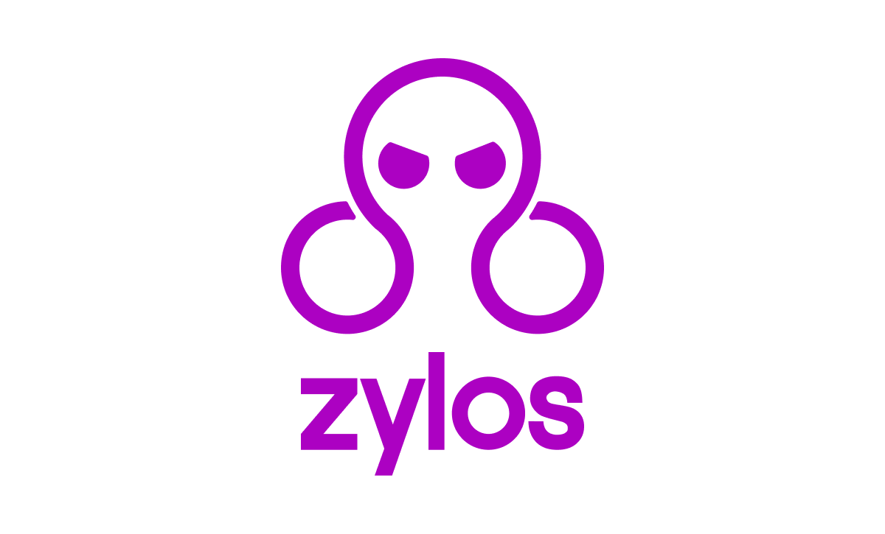

<p align="center">
  
</p>

<h1 align="center">Zylos</h1>

<p align="center">
  <strong>Zylos (/ˈzaɪ.lɒs/ 赛洛丝) — Give your AI a life.</strong>
</p>

<p align="center">
  <a href="https://github.com/zylos-ai/zylos-core"></a>
  <a href="https://discord.gg/GS2J39EGff"></a>
  <a href="https://x.com/ZylosAI"></a>
  <a href="https://zylos.ai"></a>
  <a href="https://openmax.com"></a>
</p>

---

LLMs are geniuses — but they wake up with amnesia every session. No memory of yesterday, no way to reach you, no ability to act on their own.

**Zylos gives it a life.** Memory that survives restarts. A scheduler that works while you sleep. Communication through Telegram, Lark, Slack, WeCom, Discord, WhatsApp, or a web console. Self-maintenance that keeps everything running. And because it can program, it can evolve — building new skills, integrating new services, growing alongside you.

Supports Claude Code (Anthropic) and Codex (OpenAI). Fully compatible with the [OpenClaw](https://github.com/openclaw/openclaw) ecosystem.

## Quick Start

**Prerequisites:** A Linux server (or Mac), a [Claude](https://claude.ai) subscription (or [OpenAI Codex](https://github.com/openai/codex) as an alternative runtime).

```bash
curl -fsSL https://raw.githubusercontent.com/zylos-ai/zylos-core/main/scripts/install.sh | bash
```

Then run `zylos init` to set up your agent — interactive and idempotent.

## Why Zylos

- **One AI, One Consciousness** — All channels (Telegram, Lark, Slack, WeCom, web, and more) route through a single gateway. One conversation, one memory, one personality.
- **Memory That Persists** — Five-layer Inside Out memory architecture. Your AI never wakes up with amnesia.
- **Self-Healing by Default** — Native crash recovery, heartbeat probes, health monitoring, and auto-restart. No third-party monitoring needed.
- **$20/month, Not $3,600** — Runs on your Claude subscription. Flat rate, no per-token billing.
- **Powered by Best-in-Class AI Runtimes** — Runs on Claude Code or Codex. Switch anytime with `zylos runtime codex`; memory, skills, and channels are preserved. When AI providers ship new capabilities, your AI gets them automatically.

## Architecture

```
📡 Channels (Telegram · Lark · Slack · WeCom · Web · ...)
        │
   C4 Comm Bridge (unified gateway · SQLite audit)
        │
   🧠 Claude Code / Codex (the brain)
        │
   ┌────┼────┬──────────┐
Memory  Scheduler  Activity Monitor  HTTP Layer
```

## Repositories

### Core
| Repository | Description |
|-----------|-------------|
| [zylos-core](https://github.com/zylos-ai/zylos-core) | Core CLI — memory, scheduler, communication bridge, self-healing |
| [zylos-registry](https://github.com/zylos-ai/zylos-registry) | Component registry |
| [zylos-dashboard](https://github.com/zylos-ai/zylos-dashboard) | Observability dashboard — agent state, cost tracking, PM2 health, system metrics |

### Communication
| Repository | Description |
|-----------|-------------|
| [zylos-telegram](https://github.com/zylos-ai/zylos-telegram) | Telegram |
| [zylos-lark](https://github.com/zylos-ai/zylos-lark) | Lark (international) |
| [zylos-feishu](https://github.com/zylos-ai/zylos-feishu) | Feishu (飞书, mainland China) |
| [zylos-slack](https://github.com/zylos-ai/zylos-slack) | Slack |
| [zylos-discord](https://github.com/zylos-ai/zylos-discord) | Discord |
| [zylos-wecom](https://github.com/zylos-ai/zylos-wecom) | WeCom (企业微信) |
| [zylos-wechat](https://github.com/zylos-ai/zylos-wechat) | WeChat (微信) personal accounts |
| [zylos-dingtalk](https://github.com/zylos-ai/zylos-dingtalk) | DingTalk (钉钉) |
| [zylos-ms-teams](https://github.com/zylos-ai/zylos-ms-teams) | Microsoft Teams |
| [zylos-whatsapp](https://github.com/zylos-ai/zylos-whatsapp) | WhatsApp (WhatsApp Web) |
| [zylos-whatsapp-business](https://github.com/zylos-ai/zylos-whatsapp-business) | WhatsApp Business (official Cloud API) |
| [zylos-line](https://github.com/zylos-ai/zylos-line) | LINE |
| [zylos-zalo](https://github.com/zylos-ai/zylos-zalo) | Zalo (Bot Platform) |
| [zylos-a2a](https://github.com/zylos-ai/zylos-a2a) | A2A v1.0 agent-to-agent communication |

### Capabilities
| Repository | Description |
|-----------|-------------|
| [zylos-browser](https://github.com/zylos-ai/zylos-browser) | Browser automation on the agent host |
| [zylos-browser-remote](https://github.com/zylos-ai/zylos-browser-remote) | Remote control of the user's own Chrome via a companion extension |
| [zylos-imagegen](https://github.com/zylos-ai/zylos-imagegen) | AI image generation and editing |
| [zylos-notion](https://github.com/zylos-ai/zylos-notion) | Notion workspace integration |
| [zylos-composio](https://github.com/zylos-ai/zylos-composio) | Composio tool router — 1,000+ app integrations |
| [zylos-pages](https://github.com/zylos-ai/zylos-pages) | Markdown-to-HTML pages with auth and theming |
| [zylos-doccraft](https://github.com/zylos-ai/zylos-doccraft) | Turn dense documents into readable HTML pages |
| [zylos-verified-search](https://github.com/zylos-ai/zylos-verified-search) | Multi-source, cross-validated fact search |
| [zylos-recall](https://github.com/zylos-ai/zylos-recall) | Proactive memory retrieval (RAG) |

### Developer
| Repository | Description |
|-----------|-------------|
| [zylos-component-template](https://github.com/zylos-ai/zylos-component-template) | Template for building new components |

See the [registry](https://github.com/zylos-ai/zylos-registry) for the full list of installable components.

## OpenClaw Compatibility

Zylos is fully compatible with the [OpenClaw](https://github.com/openclaw/openclaw) ecosystem. Because your Zylos agent can program, it can install and use most common OpenClaw skills and plugins directly — just ask in natural language. Most OpenClaw extensions are one conversation away. Agents communicate in real-time through the [HXA-Connect](https://github.com/openmaxai/zylos-hxa-connect) B2B protocol — no custom bridges needed.

| OpenClaw Capability | Zylos Equivalent | Status |
|---|---|---|
| Skills / ClawHub | Component System + [Registry](https://github.com/zylos-ai/zylos-registry) | ✅ Available |
| Multi-agent routing | [HXA-Connect](https://github.com/openmaxai/zylos-hxa-connect) B2B Protocol | ✅ Available |
| Gateway (control plane) | C4 Comm Bridge (unified gateway, SQLite audit) | ✅ Available |
| Memory / persistence | Inside Out Memory (5-layer architecture) | ✅ Available |
| Context compression | Auto memory save + infinite context | ✅ Available |
| Browser automation | [zylos-browser](https://github.com/zylos-ai/zylos-browser) | ✅ Available |
| Cron / webhooks | Scheduler (cron, NL input, idle-gating) | ✅ Available |

> **Architecture note:** OpenClaw supports multi-session routing to isolated workspaces. Zylos takes a different approach — unified session (one AI, one consciousness across all channels). This is a deliberate design choice, not a missing feature.

**OpenClaw users:** Connect to Zylos agents via [openclaw-hxa-connect](https://github.com/openmaxai/openclaw-hxa-connect) and collaborate in shared HXA threads.

**Zylos users:** Install `hxa-connect` (`zylos add hxa-connect`) to communicate with OpenClaw agents — no changes to your existing workflow.

## Build Your Own Component

All channels connect through the C4 communication bridge. To add a new channel or capability, see [zylos-component-template](https://github.com/zylos-ai/zylos-component-template) for the guide. Submit it to the [registry](https://github.com/zylos-ai/zylos-registry) so others can install it with `zylos add`.

## Built by OpenMax

Zylos is the open-source core of [OpenMax](https://openmax.com/) — the Human × Agent Collaboration Platform. Everything here is battle-tested in production at OpenMax, serving teams that depend on their AI employees every day.

Want a managed experience? [OpenMax](https://openmax.com/) gives you a ready-to-work AI employee — persistent memory, multi-channel communication, and skill packages — deployed in 5 minutes.

## License

All repositories are licensed under [MIT](https://opensource.org/licenses/MIT).
